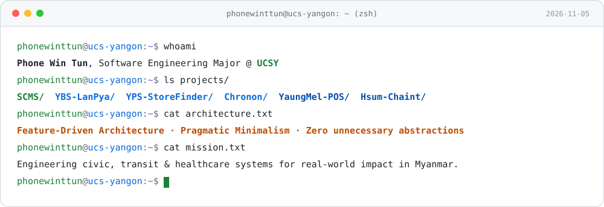
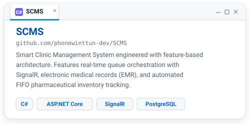
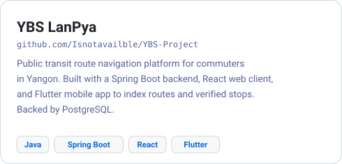
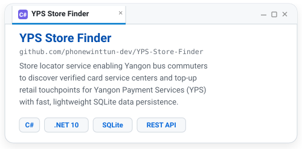
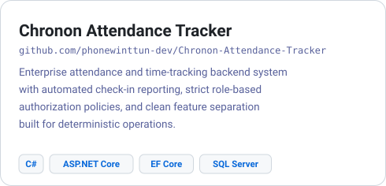
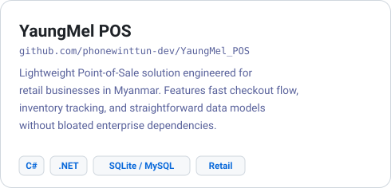
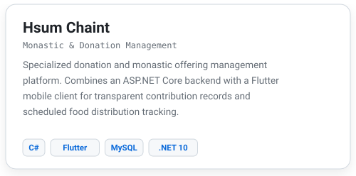
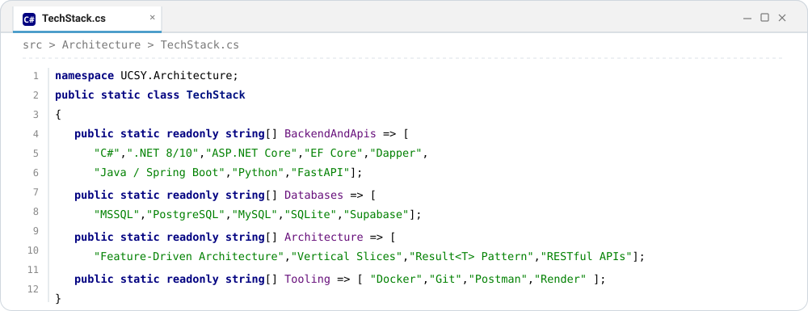

<picture>
  <source media="(prefers-color-scheme: dark)" srcset="assets/terminal-dark.svg">
  
</picture>

[LinkedIn](https://www.linkedin.com/in/phone-wint-tun-dev) · [Email](mailto:phonewinttun173@gmail.com) · [GitHub](https://github.com/phonewinttun-dev)

I am an undergraduate Software Engineering student at the **University of Computer Studies, Yangon (UCSY)**. I build backend systems, web APIs, and practical software focused on engineering reliable, community-first solutions to tackle real-world challenges in Myanmar.

I follow feature-driven architecture and pragmatic minimalism: cohesive feature folders, explicit data flows, surgical refactoring, and zero unnecessary abstractions. If a problem can be solved with standard libraries or simpler design, I keep it simple.

---

### Featured Work

  <a href="https://github.com/phonewinttun-dev/SCMS"><picture><source media="(prefers-color-scheme: dark)" srcset="assets/tile-scms-dark.svg"></picture></a>
  <a href="https://github.com/Isnotavailble/YBS-Project"><picture><source media="(prefers-color-scheme: dark)" srcset="assets/tile-ybs-dark.svg"></picture></a>

  <a href="https://github.com/phonewinttun-dev/YPS-Store-Finder"><picture><source media="(prefers-color-scheme: dark)" srcset="assets/tile-yps-dark.svg"></picture></a>
  <a href="https://github.com/phonewinttun-dev/Chronon-Attendance-Tracker"><picture><source media="(prefers-color-scheme: dark)" srcset="assets/tile-chronon-dark.svg"></picture></a>

  <a href="https://github.com/phonewinttun-dev/YaungMel_POS"><picture><source media="(prefers-color-scheme: dark)" srcset="assets/tile-yaungmel-dark.svg"></picture></a>
  <picture><source media="(prefers-color-scheme: dark)" srcset="assets/tile-hsumchaint-dark.svg"></picture>

---

### Architecture & Tooling

<picture>
  <source media="(prefers-color-scheme: dark)" srcset="assets/stack-dark.svg">
  
</picture>

---

### Engineering Principles & Focus

* Architecture: Feature-Driven Architecture (Feature-based organization), Vertical Slices, Result<T> pattern, RESTful API design.
* Data Access & Performance: EF Core and Dapper hybrid approach (Dapper for fast, predictable reads; EF Core for domain consistency), query tuning, and mobile-optimized pagination.
* Security & Reliability: Proactive vulnerability analysis (OWASP Web Security, IDOR defense), strict input validation, concurrency safety testing, and deterministic testability.
* Pragmatic Codebase Health: Zero speculative layers, surgical refactoring, and eliminating third-party dependency bloat where native code suffices.

---

### Activity

<picture>
  <source media="(prefers-color-scheme: dark)" srcset="https://raw.githubusercontent.com/phonewinttun-dev/phonewinttun-dev/output/github-snake-dark.svg">
  <source media="(prefers-color-scheme: light)" srcset="https://raw.githubusercontent.com/phonewinttun-dev/phonewinttun-dev/output/github-snake.svg">
  
</picture>
